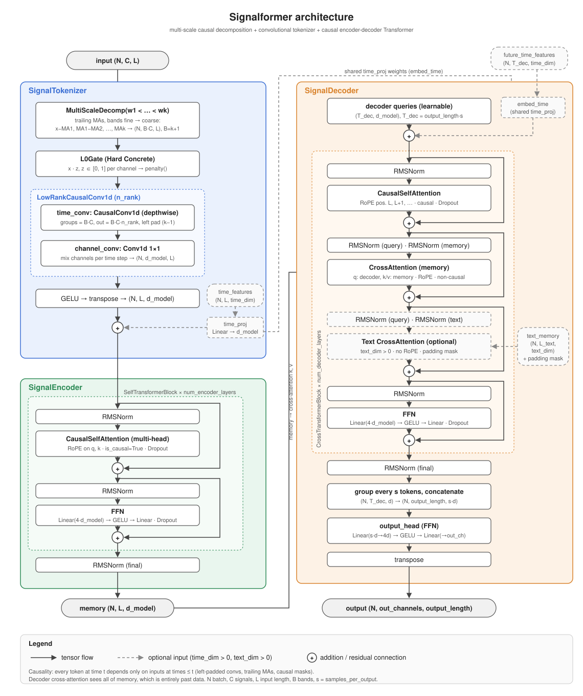

# Signalformer

A causal encoder-decoder Transformer for multivariate signal forecasting, written in PyTorch.

Signalformer splits each input signal into multi-scale frequency bands, selects useful bands with a learnable L0 gate, tokenizes them with a low-rank causal convolution, and forecasts future steps with a causal encoder-decoder Transformer. Every output depends only on past inputs, so the model can be trained and evaluated on time-ordered data without look-ahead leakage.

<picture>
  <source media="(prefers-color-scheme: dark)" srcset="docs/architecture-dark.svg">
  
</picture>

## Features

- **Multi-scale decomposition**: trailing moving averages split each signal into bands from fine to coarse (`x − MA_w1, MA_w1 − MA_w2, …, MA_wk`). The bands sum back to the input exactly.
- **Learned feature selection**: a Hard Concrete L0 gate learns a per-band weight that can be exactly zero.
- **Convolutional tokenizer**: a depthwise separable causal convolution, configurable as a sum of `n_rank` rank-1 convolutions.
- **Causal Transformer**: pre-norm blocks with RMSNorm, rotary position embeddings (RoPE) on queries and keys, and `F.scaled_dot_product_attention`.
- **Non-autoregressive decoder**: learnable queries predict all future steps in one pass.
- **Optional inputs**: calendar or other known-in-advance time features for past and future steps, and cross-attention to embeddings from an external text encoder.
- **Flexible output**: configurable output width (`out_channels`) and a coarser output frequency (`samples_per_output`).

## Requirements

- Python 3.10+
- PyTorch 2.4+ (for `nn.RMSNorm`)

## Quick start

```python
import torch
from model import Signalformer

model = Signalformer(
    in_channels=5,          # number of input signals
    in_len=128,             # input length
    d_model=64,
    kernel_size=3,
    output_length=4,        # number of output steps
    num_heads=4,
    ma_windows=(5, 20, 60), # 4 bands per signal
)

x = torch.randn(32, 5, 128)  # (N, C, L)
y = model(x)                 # (N, out_channels, output_length) = (32, 1, 4)
```

### Optional inputs

```python
model = Signalformer(
    in_channels=5, in_len=128, d_model=64, kernel_size=3, output_length=4, num_heads=4,
    time_dim=6,             # width of time features
    text_dim=768,           # width of external text embeddings
    out_channels=3,         # values per output step
    samples_per_output=7,   # e.g. daily input -> weekly output
)

y = model(
    x,                                      # (N, 5, 128)
    time_features=past_time,                # (N, 128, 6)
    future_time_features=future_time,       # (N, 4 * 7, 6), known in advance
    text_memory=text_embeddings,            # (N, L_text, 768)
    text_padding_mask=text_padding_mask,    # (N, L_text) bool, True = padding
)                                           # (N, 3, 4)
```

## Training

Add the gate penalty to the task loss. It is the expected number of open gates, so it pushes unused bands toward zero.

```python
gate_params = [model.tokenizer.gate.log_alpha]
other_params = [p for p in model.parameters() if p is not gate_params[0]]
optimizer = torch.optim.AdamW([
    {"params": other_params, "lr": 1e-3, "weight_decay": 1e-2},
    {"params": gate_params, "lr": 1e-2, "weight_decay": 0.0},
])

with torch.autocast("cuda", dtype=torch.bfloat16):
    pred = model(x)
    loss = task_loss(pred, target) + lam * model.penalty()
loss.backward()
optimizer.step()
```

Start with `lam` so the penalty is roughly 1–10% of the task loss.

## Usage notes

- **Keep the data pipeline causal.** Normalize inputs with statistics from past data only, and validate with time-ordered (walk-forward) splits rather than random splits.
- **Drop the warm-up period.** The first `max(ma_windows) − 1` steps use incomplete moving-average windows. Keep `in_len` well above the largest window.
- **Prefer stationary inputs.** Use differences, log ratios or rates of change instead of drifting levels. RMSNorm does not remove the mean.
- **Encode time features carefully.** Use sin/cos pairs for cyclical fields and 0/1 flags for known events. Avoid absolute year features, which force the model to extrapolate on later test periods.
- **Only use information available at forecast time.** Future time features must be known in advance, and text must have been available before the end of the input window.
- **Check gate stability.** Correlated bands may be selected arbitrarily. Trust a selection only if it is stable across seeds and validation folds.

## Documentation

- [`docs/architecture.html`](docs/architecture.html): detailed design reference for every module
- [`docs/architecture.pdf`](docs/architecture.pdf): the same reference as a PDF
- [`docs/architecture.svg`](docs/architecture.svg) / [`docs/architecture-dark.svg`](docs/architecture-dark.svg): architecture diagram (light / dark)

## License

[MIT](LICENSE)
